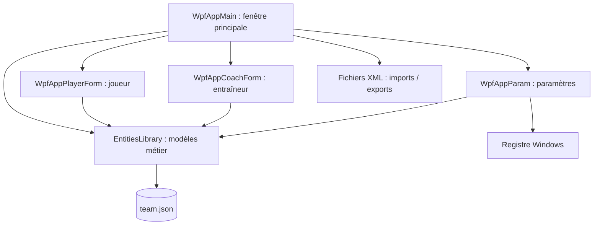

<div align="center">

# ⚽ Football Club Manager

### Gestion d'effectif footballistique • Application desktop C# / WPF


**Une application Windows pour organiser l'effectif d'un club de football : joueurs, entraîneurs, photos et fichiers d'équipe.**


*Visuel graphique présent dans le projet (ce n'est pas une capture d'écran de l'application en fonctionnement).*

[Découvrir les interfaces](#-interfaces-du-projet) · [Fonctionnalités](#-fonctionnalités) · [Installation](#-installation-et-exécution) · [Architecture](#-architecture)

</div>

---

## 📖 Présentation

**Football Club Manager** est un projet d'application de bureau développé en **C# avec Windows Presentation Foundation (WPF)**. Il permet de gérer les membres d'une équipe de football à travers une interface graphique répartie en plusieurs fenêtres.

Le projet met en pratique la programmation orientée objet, les interfaces XAML, les collections liées à l'interface, la sérialisation JSON/XML et la persistance de paramètres Windows.

### En un coup d'œil

| Domaine | Technologies et concepts |
| --- | --- |
| Interface | C#, WPF, XAML, DataGrid, fenêtres modales |
| Modèle métier | `Person`, `Player`, `Coach`, `Team` |
| Données | Newtonsoft.Json, `team.json`, XML |
| Paramètres | Registre Windows (`HKEY_CURRENT_USER`) |
| Organisation | Solution Visual Studio à plusieurs projets, .NET 8 |

---

## 🖥️ Interfaces du projet

Le code source contient **quatre écrans WPF** : la fenêtre principale, le formulaire joueur, le formulaire entraîneur et la fenêtre de paramètres. Les images ci-dessous proviennent directement des ressources du dépôt ; elles montrent les éléments graphiques utilisés, **pas des captures des fenêtres complètes**.

### 01 — Tableau de bord de l'équipe


La fenêtre principale `WpfAppMain/MainWindow.xaml` comporte **deux tableaux (`DataGrid`)** : un pour les joueurs et un pour les entraîneurs. Chaque tableau peut afficher les personnes avec leur photo et leurs informations essentielles.

**Actions présentes dans l'interface :** ajout, suppression, import et export d'un joueur ou d'un entraîneur. La fenêtre principale propose également des opérations d'import/export de l'équipe complète en JSON.

### 02 — Création d'un joueur

<div align="center">

</div>

Le formulaire `WpfAppPlayerForm/CreatePlayerForm.xaml` permet de renseigner :

- prénom et nom ;
- date de naissance ;
- poste sur le terrain ;
- numéro de maillot ;
- photographie personnelle choisie depuis le disque.

Les informations sont transformées en objet `Player` puis ajoutées à l'équipe. Le code prévoit une validation élémentaire du numéro de maillot.

### 03 — Création d'un entraîneur

<div align="center">

</div>

Le formulaire `WpfAppCoachForm/CreateCoachForm.xaml` permet de saisir l'identité, la date de naissance, le rôle et la photo d'un entraîneur. Il crée un objet `Coach` et l'enregistre dans la collection de l'équipe.

### 04 — Paramètres de l'application

La fenêtre `WpfAppParam/ParametresWindow .xaml` permet de configurer un emplacement de dossier ainsi que les dimensions de la fenêtre principale. Les paramètres sont lus et enregistrés dans le **registre Windows**, via `MyAppParam`.

> **À noter :** l'archive fournit les fichiers XAML et les ressources graphiques, mais aucune capture complète des quatre interfaces en cours d'exécution. Pour montrer leur rendu exact sur GitHub, il faudra réaliser des captures depuis l'application.

---

## ✅ Fonctionnalités

| Fonction | Présence dans le code |
| --- | --- |
| Afficher les joueurs et entraîneurs dans deux tableaux | ✅ |
| Ajouter un joueur avec poste, maillot, date de naissance et photo | ✅ |
| Ajouter un entraîneur avec rôle et photo | ✅ |
| Supprimer un joueur ou un entraîneur | ✅ |
| Importer et exporter un joueur en XML | ✅ |
| Importer et exporter un entraîneur en XML | ✅ |
| Importer et exporter une équipe en JSON | ✅ |
| Initialiser le fichier `team.json` s'il n'existe pas | ✅ |
| Sauvegarder des paramètres dans le registre Windows | ✅ |
| Service API métier pour les données de l'équipe | ❌ Non présent |

*✅ signifie que le code correspondant est présent, pas qu'une campagne de tests a été réalisée.*

---

## 🧩 Architecture



### Structure du dépôt

```text
.
├── projet-final.sln                   # Solution Visual Studio
├── Person/                            # Bibliothèque EntitiesLibrary
│   ├── Person.cs                      # Classe de base
│   ├── Player.cs                      # Joueur
│   ├── Coach.cs                       # Entraîneur
│   ├── Team.cs                        # Effectif + sauvegarde JSON
│   └── MyAppParam.cs                  # Paramètres Windows
├── WpfAppMain/                        # Fenêtre principale et DataGrid
│   ├── MainWindow.xaml
│   └── MainWindow.xaml.cs
├── WpfAppPlayerForm/                  # Formulaire de joueur
│   ├── CreatePlayerForm.xaml
│   └── imgPlayerForm2.png
├── WpfAppCoachForm/                   # Formulaire d'entraîneur
│   ├── CreateCoachForm.xaml
│   └── imgCoachForm5.png
├── WpfAppParam/                       # Paramètres utilisateur
│   └── ParametresWindow .xaml
├── Picture/                           # Illustrations d'exemple
└── IBackgroundImageChanger/          # Projet ASP.NET Core séparé
```

`IBackgroundImageChanger` est un projet **ASP.NET Core Web API** également présent dans la solution. Dans l'archive, son contrôleur expose un exemple `WeatherForecast` ; il n'implémente pas actuellement un service de changement de fond pour l'application WPF.

---

## 💾 Gestion des données

La classe `Team` contient deux collections :

```csharp
public List<Player> Players { get; private set; }
public List<Coach> Coachs { get; private set; }
```

Elle utilise **Newtonsoft.Json** pour sérialiser et désérialiser l'effectif dans un fichier local `team.json`. La fenêtre principale charge ce fichier au démarrage et le crée s'il n'existe pas.

Les fonctions d'import/export individuel utilisent `XmlSerializer`. Les listes affichées dans la fenêtre principale reposent sur `ObservableCollection<Player>` et `ObservableCollection<Coach>` afin de refléter les ajouts et suppressions dans l'interface.

Les chemins des photos sélectionnées sont enregistrés dans le modèle. En cas de déplacement de l'application vers un autre ordinateur, les chemins locaux peuvent ne plus être valables.

---

## 🚀 Installation et exécution

### Prérequis

- **Windows** (WPF est une technologie desktop Windows) ;
- **.NET 8 SDK** ;
- Visual Studio avec les outils de développement desktop .NET, ou le terminal `dotnet` ;
- accès à NuGet pour restaurer les dépendances.

### Avec Visual Studio

1. Cloner ou télécharger le dépôt.
2. Ouvrir `projet-final.sln`.
3. Restaurer les packages NuGet si nécessaire.
4. Définir **WpfAppMain** comme projet de démarrage.
5. Lancer avec **F5**.

### Avec le terminal (PowerShell)

```powershell
git clone <URL_DE_VOTRE_DEPOT>
cd <NOM_DU_DEPOT>
dotnet restore projet-final.sln
dotnet build projet-final.sln
dotnet run --project WpfAppMain/WpfAppMain.csproj
```

**Remarque :** les commandes reflètent les fichiers du dépôt, mais la compilation et l'exécution n'ont pas été validées dans cet environnement Windows. Le projet contient plusieurs exécutables WPF ; `WpfAppMain` est celui à démarrer pour l'application de gestion d'équipe.

---

## 🛠️ Difficultés techniques intéressantes

- **POO et héritage :** `Player` et `Coach` dérivent de la classe `Person`.
- **Data binding WPF :** affichage d'objets dans les `DataGrid`, avec des `ObservableCollection`.
- **Séparation en projets :** les fenêtres graphiques dépendent de la bibliothèque métier partagée.
- **Persistance :** lecture/écriture JSON, import/export XML et paramètres dans la registry.
- **Gestion de fichiers :** sélection de photographies et boîtes de dialogue d'ouverture/enregistrement.


## 🎓 Contexte du projet

Projet de développement desktop en **C# / WPF**, réalisé dans un cadre d'apprentissage et conservé ici comme démonstration de compétences en interfaces Windows, structuration du code, programmation orientée objet et sérialisation.

---

<div align="center">

**Football Club Manager — C# · WPF · .NET 8**

*Projet de portfolio · Gestion d'effectif footballistique*

</div>
